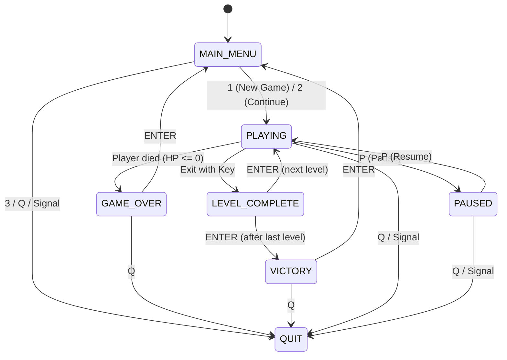

# Terminal dungeon game for CSE-3200 (Python + curses).

## Architecture

### Project Structure
```text
dungeon-game/
  src/
    main.py               entry point, curses.wrapper, crash logging
    game.py               Game class: loop, state machine, event handlers, signals
    engine/               Member 1: terminal and system side
      input_manager.py    keys -> actions (non-blocking)
      renderer.py         drawing with curses
      timer.py            fixed frame rate
      collision.py        wall / bounds checks
      events.py           EventManager + event names
      states.py           State enum
      logger.py           logging to logs/game.log
      utils.py            paths, sign()
    dungeon/              Member 2: game content side
      entities.py         Player, Enemy, Key, Coin, Trap, Exit
      level.py            loads levels/*.txt
      rules.py            what happens when things touch
      save_manager.py     JSON save/load
  levels/                 level1.txt level2.txt level3.txt
  tests/                  pytest tests
  docs/                   CONTRACT.md, TESTING.md, OS_CONCEPTS.md
  logs/  saves/           created while playing (not in Git)
```

### Game Loop
The core execution loop coordinates input, update, rendering, and timing:
```text
read input -> update -> draw -> wait
```
- **Read input**: `InputManager.get_action()` drains queued keys non-blockingly from the kernel input buffer without waiting for Enter.
- **Update**: The current state handler processes input, updates entity positions, evaluates collision rules via `EventManager`, and triggers state transitions.
- **Draw**: `Renderer` writes character escape sequences and buffers the frame, pushing updates to curses terminal output (`stdout`).
- **Wait**: `FrameClock.tick()` requests the OS scheduler to pause execution via `time.sleep()`, maintaining a steady 10 FPS without busy waiting (preventing 100% CPU core usage).

### State Diagram
The game flow is driven by a finite state machine:
- `MAIN_MENU` -> `PLAYING` (via `1` New Game or `2` Continue)
- `PLAYING` <-> `PAUSED` (toggle pause with `P`)
- `PLAYING` -> `GAME_OVER` (when player HP reaches 0)
- `PLAYING` -> `LEVEL_COMPLETE` (when player reaches Exit `X` with Key `K`)
- `LEVEL_COMPLETE` -> next level (`PLAYING`) or `VICTORY` (after the last level is cleared)
- `GAME_OVER` / `VICTORY` -> `MAIN_MENU` (via `ENTER`)
- Any active state -> `QUIT` (via `Q`, menu option `3`, or OS signals `SIGINT`/`SIGTERM`)

```text
                  +-------------+
                  |  MAIN_MENU  |
                  +------+------+
                         | (1: New Game / 2: Continue)
                         v
                  +-------------+   (P: Pause)   +------------+
                  |             |<-------------->|   PAUSED   |
                  |             |   (P: Resume)  +------------+
                  |   PLAYING   |
                  |             |   (Health <= 0) +------------+
                  |             +---------------->| GAME_OVER  |
                  +------+------+                 +-----+------+
                         |                              |
                         | (Exit with key)              | (ENTER)
                         v                              v
                +-----------------+               [MAIN_MENU]
                | LEVEL_COMPLETE  |
                +--------+--------+
                         | (ENTER)
           +-------------+-------------+
           | (has next level)          | (after last level)
           v                           v
     [Next Level]                 +------------+
     (-> PLAYING)                 |  VICTORY   |
                                  +-----+------+
                                        | (ENTER)
                                        v
                                   [MAIN_MENU]
```



### OS Concepts Map
This project is a user-space application demonstrating operating system principles including terminal driver control, non-blocking I/O, process management, signals, atomic file replacements, and scheduling.

For the complete mapping between features and OS concepts, see the [OS Concepts Map](docs/OS_CONCEPTS.md).