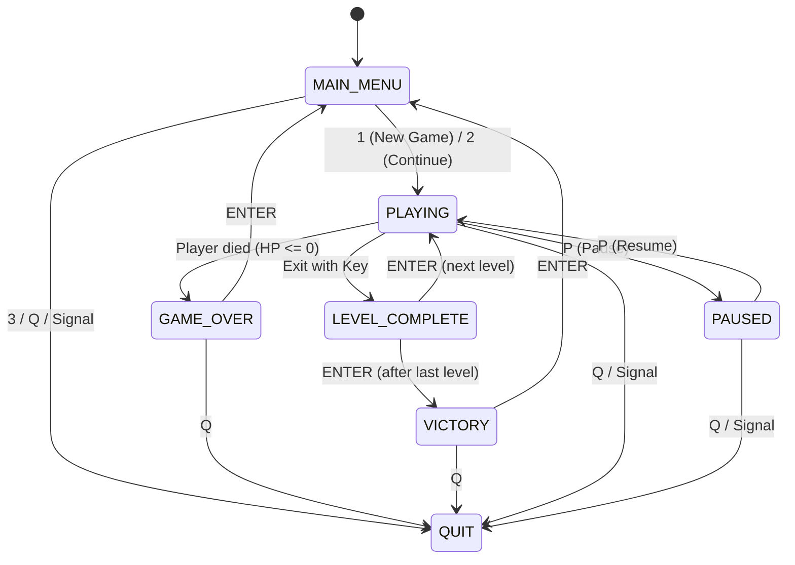

# Dungeon Escape

A terminal-based dungeon exploration game built in Python using standard-library `curses`. Developed as a paired project for **CSE-3200 (Operating Systems Sessional)**.

---

## How to Play

### Objective
Navigate through dangerous dungeons, avoid or outsmart patrolling enemies, evade hidden floor traps, collect gold coins, retrieve the dungeon **Key (`K`)**, and reach the **Exit (`X`)** to advance to the next level. Complete all levels to achieve victory!

### Controls
| Key | Action | Context |
| :--- | :--- | :--- |
| **`W` / `A` / `S` / `D`** or **Arrow Keys** | Move Up / Left / Down / Right | In Game |
| **`P`** | Pause / Resume Game | In Game |
| **`Q`** | Quit Game / Return | In Game / Menus |
| **`1`** | Start New Game | Main Menu |
| **`2`** | Continue from Checkpoint | Main Menu |
| **`3`** | Quit Application | Main Menu |
| **`ENTER`** | Advance Level / Return to Menu | Level Complete / Game Over / Victory |

### Map Symbols
| Symbol | Entity | Description |
| :---: | :--- | :--- |
| `@` | **Player** | Your character (Green `@`). Starts with 3 HP. |
| `#` | **Wall** | Impassable stone walls blocking movement. |
| ` ` | **Floor** | Walkable open dungeon corridors. |
| `$` | **Coin** | Treasure item awarding **+10 Score**. |
| `K` | **Key** | Required to unlock the dungeon exit gate. |
| `X` | **Exit** | Level exit. Locked until Key `K` is collected. |
| `T` / `^` | **Trap** | Deals 1 damage to player upon stepping on it (has 1s cooldown). |
| `E` | **Patrol Enemy (H)** | Enemy patrolling horizontally left-to-right. |
| `V` | **Patrol Enemy (V)** | Enemy patrolling vertically up-and-down. |
| `R` | **Random Enemy** | Enemy moving unpredictably in random directions. |
| `C` | **Chaser Enemy** | Aggressive enemy actively hunting down the player. |

---

## Installation & Setup

### Prerequisites
- **Python 3.10+** (tested on Python 3.10 through 3.14)
- **Terminal Window:** At least 80 columns $\times$ 24 rows recommended.

### Linux / macOS / WSL (Ubuntu)
Python includes standard curses support natively:
```bash
# 1. Clone the repository
git clone https://github.com/badruddin-tasnim/terminal-dungeon-game.git
cd terminal-dungeon-game

# 2. Set up virtual environment
python3 -m venv venv
source venv/bin/activate

# 3. Install testing dependencies
pip install pytest

# 4. Run the game
python3 src/main.py
```

### Windows (Native Command Prompt / PowerShell)
On Windows, install `windows-curses` for terminal emulation:
```powershell
# 1. Set up virtual environment
python -m venv venv
.\venv\Scripts\activate

# 2. Install dependencies (including curses port for Windows)
pip install pytest windows-curses

# 3. Run the game
python src/main.py
```

*Optional Debug Mode:* Set `DUNGEON_DEBUG=1` in your environment to enable verbose debug logging to `logs/game.log`:
```bash
DUNGEON_DEBUG=1 python3 src/main.py
```

---

## Adding Your Own Level

Levels are plain text files discovered automatically from the `levels/` directory (`levels/level1.txt`, `levels/level2.txt`, etc.). The game dynamically parses levels sorted alphabetically without any code modifications.

To create a new level (e.g., `levels/level4.txt`):
1. Create a rectangular grid using `#` for outer walls and interior obstacles.
2. Place exactly **one** player starting position (`@`).
3. Place exactly **one** key (`K`) and **one** exit (`X`).
4. Optionally place coins (`$`), traps (`T`), and enemies (`E`, `V`, `R`, `C`).
5. Ensure every line is padded to the exact same width with spaces.
6. Run `python -m pytest` — the automated Breadth-First Search (BFS) reachability validator will automatically verify that your level is solvable!

---

## Running the Tests

The project includes unit and integration tests covering game entities, movement, collision, level reachability, event-driven rules, and atomic save/load:

```bash
python -m pytest
```

For the manual test matrix and QA procedures, see [docs/TESTING.md](docs/TESTING.md).

---

## Team & File Ownership

This project was built following a structured 7-day cooperative team workflow:

| Team Member | Role | Owned Modules / Responsibilities |
| :--- | :--- | :--- |
| **Md. Badruddin Tasnim** (`Member 1`) | **Engine & System Architecture** | `src/main.py`, `src/game.py`<br>`src/engine/input_manager.py` (cbreak non-blocking input)<br>`src/engine/renderer.py` (curses rendering & double-buffering)<br>`src/engine/timer.py` (CPU scheduling & FrameClock)<br>`src/engine/collision.py` (bounds checking & wall collision)<br>`src/engine/events.py` (EventManager pub-sub bus)<br>`src/engine/states.py` (State machine enum)<br>`src/engine/logger.py` & `src/engine/utils.py`<br>`tests/test_collision.py`, `tests/test_events.py` |
| **Mezbah Saklain** (`Member 2`) | **Game Mechanics & Content** | `src/dungeon/entities.py` (Player, Enemy AI, Items)<br>`src/dungeon/level.py` (dynamic level loader & file I/O)<br>`src/dungeon/rules.py` (tile interaction & combat rules)<br>`src/dungeon/save_manager.py` (atomic JSON persistence)<br>`levels/level1.txt`, `level2.txt`, `level3.txt`<br>`tests/test_entities.py`, `tests/test_level.py`<br>`tests/test_rules.py`, `tests/test_save.py` |

---

## Architecture

### Project Structure
```text
dungeon-game/
  src/
    main.py               entry point, curses.wrapper, crash logging
    game.py               Game class: loop, state machine, event handlers, signals
    engine/               Member 1: terminal and system side
      input_manager.py    keys -> actions (non-blocking)
      renderer.py         drawing with curses
      timer.py            fixed frame rate
      collision.py        wall / bounds checks
      events.py           EventManager + event names
      states.py           State enum
      logger.py           logging to logs/game.log
      utils.py            paths, sign()
    dungeon/              Member 2: game content side
      entities.py         Player, Enemy, Key, Coin, Trap, Exit
      level.py            loads levels/*.txt
      rules.py            what happens when things touch
      save_manager.py     JSON save/load
  levels/                 level1.txt level2.txt level3.txt
  tests/                  pytest tests
  docs/                   CONTRACT.md, TESTING.md, OS_CONCEPTS.md
  logs/  saves/           created while playing (not in Git)
```

### Game Loop
The core execution loop coordinates input, update, rendering, and timing:
```text
read input -> update -> draw -> wait
```
- **Read input**: `InputManager.get_action()` drains queued keys non-blockingly from the kernel input buffer without waiting for Enter.
- **Update**: The current state handler processes input, updates entity positions, evaluates collision rules via `EventManager`, and triggers state transitions.
- **Draw**: `Renderer` writes character escape sequences and buffers the frame, pushing updates to curses terminal output (`stdout`).
- **Wait**: `FrameClock.tick()` requests the OS scheduler to pause execution via `time.sleep()`, maintaining a steady 10 FPS without busy waiting (preventing 100% CPU core usage).

### State Diagram
The game flow is driven by a finite state machine:
- `MAIN_MENU` -> `PLAYING` (via `1` New Game or `2` Continue)
- `PLAYING` <-> `PAUSED` (toggle pause with `P`)
- `PLAYING` -> `GAME_OVER` (when player HP reaches 0)
- `PLAYING` -> `LEVEL_COMPLETE` (when player reaches Exit `X` with Key `K`)
- `LEVEL_COMPLETE` -> next level (`PLAYING`) or `VICTORY` (after the last level is cleared)
- `GAME_OVER` / `VICTORY` -> `MAIN_MENU` (via `ENTER`)
- Any active state -> `QUIT` (via `Q`, menu option `3`, or OS signals `SIGINT`/`SIGTERM`)



### OS Concepts Map
This project is a user-space application demonstrating operating system principles including terminal driver control, non-blocking I/O, process management, signals, atomic file replacements, and scheduling.

For the complete mapping between features and OS concepts, see the [OS Concepts Map](docs/OS_CONCEPTS.md).
